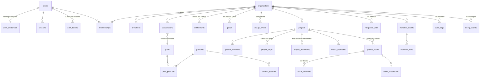

# Modelo de dados (banco novo, schema `zro`)

Fonte de verdade: `infra/migrations/0001_foundation.sql`, `0002_rls.sql`, `0003_catalog.sql`. RLS ligado em todas as
tabelas (teste em `packages/db/test/rls.test.ts`).

| Tabela                                                                | Quem lê (zro_app)                                                                                     | Quem escreve                                                 |
| --------------------------------------------------------------------- | ----------------------------------------------------------------------------------------------------- | ------------------------------------------------------------ |
| users                                                                 | a si mesmo e quem divide a organização ativa                                                          | a si mesmo (`display_name`); sistema                         |
| auth_credentials, auth_tokens, rate_limit_attempts, billing_events    | ninguém                                                                                               | sistema                                                      |
| sessions                                                              | as próprias (sem `token_hash`)                                                                        | sistema                                                      |
| organizations                                                         | membros                                                                                               | `create_organization()`; dono/admin (nome)                   |
| memberships                                                           | os próprios + membros da org ativa                                                                    | dono/admin (admin não mexe em dono); trigger garante um dono |
| invitations                                                           | dono/admin                                                                                            | dono/admin; aceitar é sistema (e-mail confirmado e igual)    |
| products, product_features, plans (ativos/aposentados), plan_products | todos                                                                                                 | sistema/console                                              |
| subscriptions                                                         | dono/admin/financeiro                                                                                 | webhook assinado ou console                                  |
| entitlements, quotas                                                  | membros                                                                                               | sistema (recalculado na mudança de assinatura)               |
| usage_events                                                          | dono/admin/gestão/financeiro                                                                          | sistema (`consumeQuota`)                                     |
| projects                                                              | dono/admin/gestão; edição/leitura nos de visibilidade "organização"; membros do projeto nos restritos | edição+                                                      |
| project_* , media_manifests, assets, locations, checksums             | quem vê o projeto                                                                                     | quem edita o projeto; worker                                 |
| workflow_events, workflow_runs                                        | membros que veem o projeto                                                                            | edição+ (publicar, reprocessar); worker muda estado          |
| audit_logs                                                            | dono/admin (org) e cada um o que fez                                                                  | inclusão em nome próprio; trigger bloqueia edição e exclusão |

Estados de etapa: `not_started`, `waiting_material`, `ready`, `processing`, `needs_review`, `done`, `failed`,
`blocked_subscription`, `unavailable` (PRD §4.2). O estado mostrado soma o gravado com a assinatura da organização
(`displayStateFor`).
