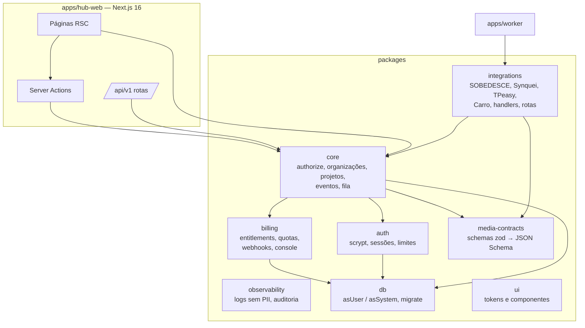
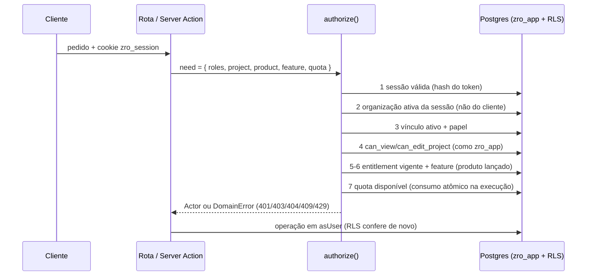
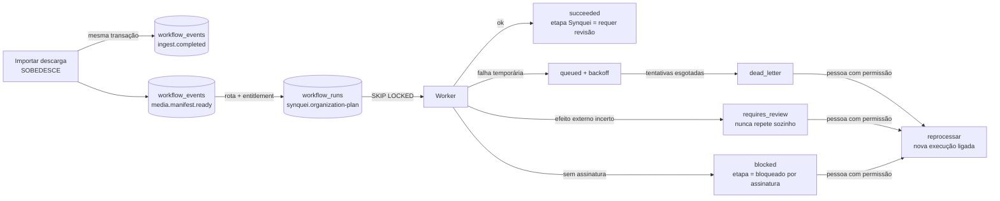

# Arquitetura do Absolute ZRO HUB

O HUB é uma **camada adicional** (PRD §12): conta central, permissões por assinatura, projeto canônico, eventos e
contratos. Os apps de cada marca continuam rodando nos ambientes deles, com login próprio, e não foram alterados.

## Contexto

```mermaid
flowchart LR
  pessoa([Pessoa / equipe]) -->|login único do HUB| hub[Absolute ZRO HUB\napps/hub-web]
  hub --> db[(Postgres NOVO\nRLS + papel zro_app)]
  worker[Worker\napps/worker] --> db
  provedor[[Provedor de pagamento\nainda não escolhido]] -.->|webhook assinado| hub
  subgraph Originais [Apps originais — só leitura, login próprio]
    cdf[Carro do Freela]
    tp[TPeasy]
    sd[SOBEDESCE desktop]
    sq[Synquei desktop]
    ns[NOSSOM]
  end
  cdf -.->|job JSON\ncarro-do-freela.job/1| hub
  tp <-.->|backup JSON v1| hub
  sd -.->|descargas.jsonl v1\n+ SOBEDESCE_copia_*.xxh64| hub
  hub -.->|prévia de organização\n(dry-run)| sq
  hub -.->|link externo| ns
```

Linhas tracejadas são arquivos que a pessoa leva de um lado para o outro ou links: nenhum app original chama o HUB
nem é chamado por ele. Isso é deliberado na Fase 1/2 (PRD §5.3, §6.2 estratégia c/d).

## Componentes



## Autorização (PRD §5.2)



Defesa em profundidade: mesmo que uma checagem do servidor falhe, as políticas RLS de `0002_rls.sql` exigem
`org_id = organização ativa` **e** vínculo ativo do usuário, com o papel `zro_app` (sem dono, sem BYPASSRLS).

## Eventos e fila (PRD §7.3)



- `idempotency_key` única por organização no evento; reprocessar a mesma execução duas vezes devolve a mesma nova.
- Rotas sem ciclo (teste `findEventCycle`). Eventos sem consumidor (ex.: `edit.timeline.ready`) ficam registrados no
  projeto: o HUB não finge processá-los.

## Dados

Modelo completo em [data-model.md](data-model.md). Ameaças e mitigação em [threat-model.md](threat-model.md).

## Deploy alvo (aguardando autorização)

HUB na Vercel (projeto novo, raiz `apps/hub-web`), Postgres em projeto Supabase **novo** (só o banco, Data API sem
acesso às tabelas do schema `zro`), worker em processo Node contínuo (Railway/Fly/VM ou cron serverless que chama
`runOnce`). Passos em [../operations/deployment-checklist.md](../operations/deployment-checklist.md).
